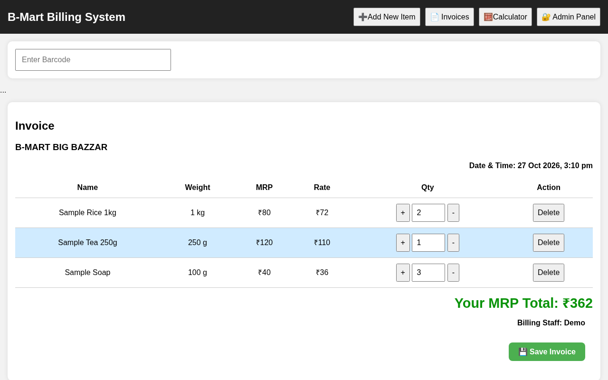
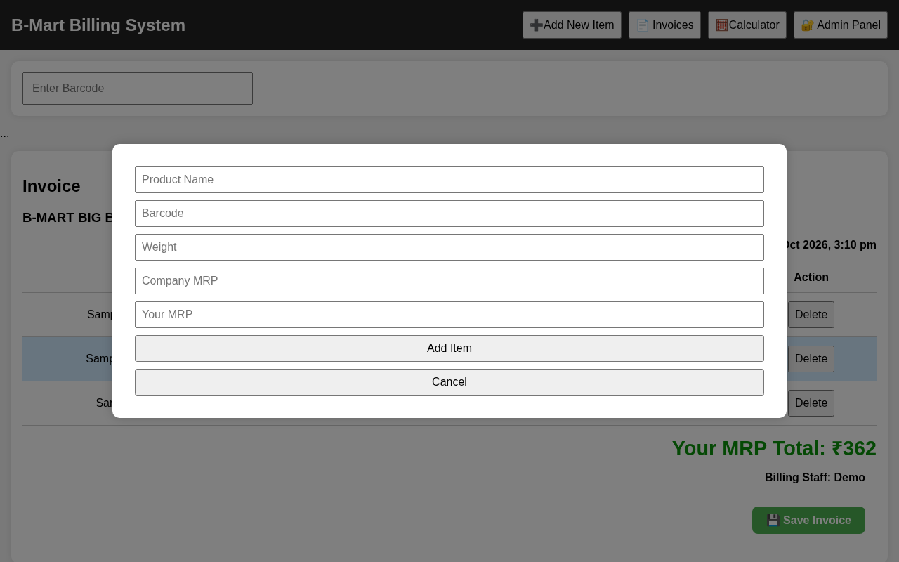
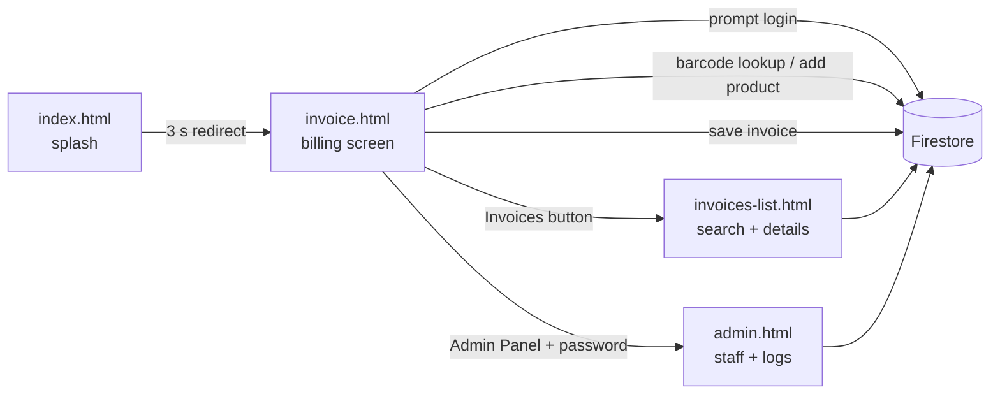

# B-Mart Billing & Invoice System

> A browser-based point-of-sale and invoicing tool built for a local retail store (B-Mart Big Bazar): barcode-driven billing, saved invoices with searchable history, staff accounts and an admin panel — a static front end on **Firebase Firestore**, no server to maintain.

[](https://ppro916.github.io/B-Mart-Invoice/)


**Live app:** <https://ppro916.github.io/B-Mart-Invoice/> — the app asks for a staff username and password that are stored in the store's own Firestore database, so the live deployment cannot be used without credentials. Run it against your own Firebase project (see [Getting started](#getting-started)).

## Screenshots

Captured at 1280×800 from a local run. The three invoice rows are **sample data injected for the screenshot** (login was skipped because the real store database is private).

| Billing screen | Add a product |
| --- | --- |
|  |  |

## Features

- **Barcode billing** — type or scan a barcode, press Enter and the product is fetched from Firestore and added to the bill; scanning it again increases the quantity.
- **Live bill table** — +/− and numeric quantity controls, delete with confirmation, running total of the store's selling price (MRP column vs. store rate shown per line).
- **Save invoice** — stores the items, staff name and timestamp in Firestore with an automatic bill number in the form `dd-mm-yyyy-001`, `…-002`, …
- **Invoice history** — searchable list (by date `dd-mm-yyyy` or bill number), newest first, with expandable item details.
- **Add products on the fly** — popup form that writes a new product (name, barcode, weight, company MRP, store rate) to Firestore, refusing duplicate barcodes.
- **Staff login** — staff sign in with a username and password checked against Firestore; the billing staff name is printed on the bill.
- **Admin panel** — register counter users, list all users and view per-user entry/exit counts from the activity log.
- **Built-in calculator** popup for quick sums at the counter.
- **Branded splash screen** — progress-bar loader that redirects to the billing page.

## Tech stack

| Area | Tools |
| --- | --- |
| Front end | HTML5, CSS3, vanilla JavaScript (no build step) |
| Data | Firebase Firestore (JS SDK 9.23.0 compat build from the Google CDN) |
| Hosting | GitHub Pages (static) |

## How it works



| Firestore collection | Used for |
| --- | --- |
| `staff/{username}` | Counter users (`name`, `username`, `password`) — read by the login prompt, written by the admin panel |
| `products/{barcode}` | Product catalogue (`name`, `weight`, `cmrp`, `ymrp`) |
| `invoices/{auto-id}` | Saved bills (`billNo`, `date`, `createdAt`, `staff`, `items[]`) |
| `usersLog/{username}` | Per-day entry/exit log shown in the admin panel |

## Getting started

```bash
git clone https://github.com/ppro916/B-Mart-Invoice.git
cd B-Mart-Invoice
python3 -m http.server 8000      # then open http://localhost:8000
```

To use your own data:

1. Create a Firebase project and enable **Cloud Firestore**.
2. Replace the `firebaseConfig` object in `invoice.html`, `admin.html` and `invoices-list.html` with your project's web config.
3. Create the `staff` and `products` collections (the admin panel can create staff users).

## Configuration

This is a static site, so there are no server environment variables. Admin access is configured in [`config.js`](config.js):

| Setting | Description |
| --- | --- |
| `adminPasswordSha256` | SHA-256 hex digest of the password for the **Admin Panel** button. Create it with `printf '%s' 'your-long-passphrase' \| sha256sum`. Leave it empty to disable the shortcut. |

> The Firebase **web** config (API key, project id, …) is public by design; what protects the data are your **Firestore security rules**. Make sure they are locked down before using real data.

## Known limitations

- Authentication is a lightweight, client-side check (staff passwords are compared in the browser with documents in Firestore). For production use, move to **Firebase Authentication** with strict Firestore security rules and never store plain-text passwords.
- The admin shortcut in `config.js` is only a UI gate for the same reason.
- `login.html` is an earlier, unfinished login page and is not part of the current flow (the splash screen opens `invoice.html`, which asks for credentials itself).

## Roadmap

- [ ] Migrate staff sign-in to Firebase Authentication and add Firestore security rules
- [ ] Printable / PDF invoice layout
- [ ] Escape user-provided text before rendering and replace the calculator's `eval`
- [ ] Daily sales summary from saved invoices

## Author

**Moreshwar Bhonde** — AI & Data Science engineering student, AI-first developer, founder of AI Nexus × Neon AI Studio.

- GitHub: [@ppro916](https://github.com/ppro916)
- Website: [neonaistudio.in](https://neonaistudio.in)

## License

[MIT](LICENSE)
